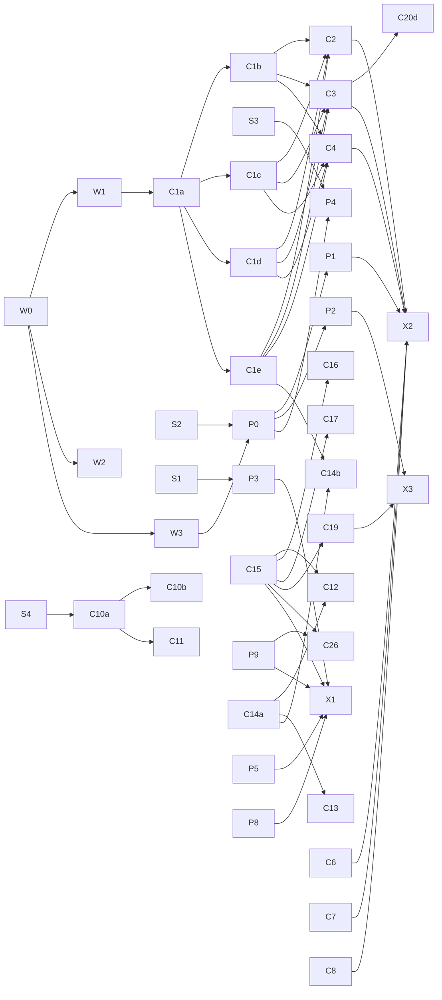

# Work breakdown

This splits [`docs/plan.md`](../plan.md) into work packages (WPs). Each one is sized for one
worktree, one issue and one PR. IDs keep the plan's names (P1, C1, K1). A letter suffix marks
a split (C1a–C1e), and the new IDs are W (groundwork), S (spikes) and X (integration).

Phases here are dependency waves, not the plan's product phases. Each WP sits in the
earliest phase where all its inputs exist, so every WP in a phase can run at once. The
milestones below map the plan's §7 exit checks onto WPs.

## Using these documents

1. Open one issue per WP, using the doc's goal and "Done when" list. The branch is
   `<type>/<issue>-<wp-id>-<slug>`, for example `feat/42-c1a-selection-model`.
2. Give each WP its own worktree, for example `../strata-components-c1a`.
3. A WP touches only the paths it owns, plus the shared files listed under
   [Shared files](#shared-files). If it needs a contract change (W1, W2), that change goes in
   its own small PR first. Everyone else then rebases.
4. Track status in the issues. These docs change only when the scope does.

## Rules that keep the work parallel

1. **strata-components never depends on strata-platform.** Components take platform values
   as plain data: the double-click interval, the text scale and the animations switch. They
   emit drag and drop intents in W1's types, and X2 binds those to P1. So no collection or
   chrome work waits on drag and drop, the long pole.
2. **Controllers before elements.** Selection, pointer intent, keyboard navigation and
   marquee are plain state machines with unit tests (C1a–C1d). The element (C1e) wires them
   to Rune, so all four can be built at once.
3. **Fake data in the gallery.** Media frames, PDF pages, thumbnails, listings and search
   results are generated in the gallery. No component waits on Strata's workers or on P7.
4. **Contracts grow by addition.** W1 and W2 publish small, stable types. A change to them is
   its own PR. Removing or renaming something in them is a decision recorded in the issue.

## Common dependencies

| Dependency | Provides | Needed by |
| --- | --- | --- |
| [W0](phase-0-groundwork/W0-scaffold.md) scaffold | One module per component, a scene registry, per-component golden and script folders, filtered bless | Every WP |
| [W1](phase-0-groundwork/W1-component-contracts.md) component contracts | Entry ids and source, collection geometry, drag/drop intents, matched-text labels | C1–C8, C14b, C17–C21, X2 |
| [W2](phase-0-groundwork/W2-look-contract.md) look contract | `Look` (Kit + extensions), density and type tokens, semantic icons, component slots, token registry | Every component, K1–K4 |
| [W3](phase-0-groundwork/W3-compositor-harness.md) compositor harness | Headless sway and Xwayland in CI, a peer process for transfer tests, a D-Bus session | P0–P5, P8 |
| [P0](phase-1-leaves/P0-transfer-substrate.md) transfer substrate | Protocol binding on winit's display, multi-MIME offers and sources, X11 selections | P1, P2, P4 |
| [C1a](phase-1-leaves/C1a-selection-model.md) selection model | Selection, anchor, cursor and restore memory, by entry id | C1b–C1e, C18, C2–C4 |
| [C1e](phase-2-composites/C1e-collection-element.md) collection element | The virtual-row element with row slots | C2, C3, C4, C14b |
| [C15](phase-1-leaves/C15-strata-dialog.md) StrataDialog | Modal shell, motion, Enter and Escape | C12, C16, C17, C19, C26 and Strata's action dialogs |
| [C10a](phase-1-leaves/C10a-highlighter.md) highlighter | syntect on a worker, checkpoints, colour spans | C10b, C11 |
| [C14a](phase-1-leaves/C14a-pixels-viewport.md) pixels viewport | Zoom, pan and fit over `Pixels` | C12, C13, C14b |
| [P9](phase-1-leaves/P9-glib-bridge.md) GLib bridge | A GIO main context on a thread, marshalled into Rune | C26 (and Strata's device code) |

## Phases

### Phase 0: Groundwork

W0 lands first. W1, W2 and W3 follow in parallel. The spikes need nothing and start on day one.

| WP | Title | Depends on |
| --- | --- | --- |
| [W0](phase-0-groundwork/W0-scaffold.md) | Parallel-ready scaffold | — |
| [W1](phase-0-groundwork/W1-component-contracts.md) | Component contracts | W0 |
| [W2](phase-0-groundwork/W2-look-contract.md) | Look contract | W0 |
| [W3](phase-0-groundwork/W3-compositor-harness.md) | Compositor test harness | W0 |
| [S1](phase-0-groundwork/S1-linux-window-baseline.md) | Linux window baseline | — |
| [S2](phase-0-groundwork/S2-transfer-beside-winit.md) | Data transfer beside winit | — |
| [S3](phase-0-groundwork/S3-foreign-parent-survey.md) | Foreign parent survey | — |
| [S4](phase-0-groundwork/S4-syntect-benchmark.md) | syntect regex backend benchmark | — |
| [S5](phase-0-groundwork/S5-upstream-and-release.md) | Rune issues, crate name, release workflow | S1–S3 for repros |

### Phase 1: Leaves

Everything here needs only phase 0.

| Lane | WPs |
| --- | --- |
| Platform | [P0](phase-1-leaves/P0-transfer-substrate.md), [P3](phase-1-leaves/P3-client-side-decorations.md), [P5](phase-1-leaves/P5-desktop-settings.md), [P6](phase-1-leaves/P6-icon-theme.md), [P7](phase-1-leaves/P7-media-output.md), [P8](phase-1-leaves/P8-single-instance.md), [P9](phase-1-leaves/P9-glib-bridge.md) |
| Look | [K1](phase-1-leaves/K1-theme-mapping.md), [K2](phase-1-leaves/K2-shape-density-type.md), [K3](phase-1-leaves/K3-icon-catalogs.md), [K4](phase-1-leaves/K4-user-overrides.md), [K6](phase-1-leaves/K6-bundled-font.md) |
| Collection | [C1a](phase-1-leaves/C1a-selection-model.md), [C5](phase-1-leaves/C5-inline-rename.md), [C24](phase-1-leaves/C24-scroll-extras.md), [C25](phase-1-leaves/C25-thumbnail-store.md) |
| Chrome | [C6](phase-1-leaves/C6-location-bar.md), [C7](phase-1-leaves/C7-browser-tabs.md), [C8](phase-1-leaves/C8-places-sidebar.md), [C15](phase-1-leaves/C15-strata-dialog.md), [C21](phase-1-leaves/C21-context-menus.md), [C22](phase-1-leaves/C22-folder-peek.md), [C23](phase-1-leaves/C23-motion-effects.md) |
| Preview | [C9](phase-1-leaves/C9-preview-drawer.md), [C10a](phase-1-leaves/C10a-highlighter.md), [C14a](phase-1-leaves/C14a-pixels-viewport.md) |
| Controls | [C20a](phase-1-leaves/C20a-slider-number-field.md), [C20b](phase-1-leaves/C20b-color-picker.md), [C20c](phase-1-leaves/C20c-tabbed-form-settings-search.md) |

### Phase 2: Composites

| Lane | WPs |
| --- | --- |
| Platform | [P1](phase-2-composites/P1-drag-and-drop.md), [P2](phase-2-composites/P2-clipboard.md), [P4](phase-2-composites/P4-foreign-parent.md) |
| Collection | [C1b](phase-2-composites/C1b-pointer-intent.md), [C1c](phase-2-composites/C1c-keyboard-navigation.md), [C1d](phase-2-composites/C1d-marquee.md), [C1e](phase-2-composites/C1e-collection-element.md) |
| Chrome | [C16](phase-2-composites/C16-progress-dock.md), [C17](phase-2-composites/C17-search-palette.md), [C18](phase-2-composites/C18-filter-bar-footer-prompt.md), [C19](phase-2-composites/C19-footer-shortcut-reference.md), [C26](phase-2-composites/C26-mount-prompts.md) |
| Preview | [C10b](phase-2-composites/C10b-code-view.md), [C11](phase-2-composites/C11-document-view.md), [C12](phase-2-composites/C12-pdf-view.md), [C13](phase-2-composites/C13-media-player.md) |
| Integration | [X1](phase-2-composites/X1-shell-demo.md) |

### Phase 3: Views

| WP | Title | Depends on |
| --- | --- | --- |
| [C2](phase-3-views/C2-columns-view.md) | ColumnsView | C1e (C1b–C1d) |
| [C3](phase-3-views/C3-icons-grid.md) | IconsGrid | C1e (C1b–C1d), C25 |
| [C4](phase-3-views/C4-list-table.md) | ListTable | C1e (C1b–C1d) |
| [C14b](phase-3-views/C14b-viewers.md) | Viewers and archive preview | C14a, C1e |
| [X3](phase-3-views/X3-clipboard-wiring.md) | Clipboard wiring | P2, C19 |

### Phase 4: Integration

| WP | Title | Depends on |
| --- | --- | --- |
| [C20d](phase-4-integration/C20d-icon-picker.md) | IconPicker | C3, K3 |
| [X2](phase-4-integration/X2-dnd-wiring.md) | Drag-and-drop wiring | P1, C2–C4, C6–C8 |

## Dependency graph

Every component also depends on W1 and W2, and the graph leaves those edges out.

## Critical paths

- **Drag and drop:** S2 → P0 → P1 → X2. This is the longest chain, and the plan's §8 risk.
  Staff S2 and P0 first.
- **Collection:** W1 → C1a → C1e → C3 → C20d. The 100k-entry performance bar sits on C1e.
  A slip there moves every view.
- **Chooser:** S3 → P4. It is short, but a failure on one compositor blocks the release
  (plan §8). So S3 covers all four compositors early.

## Lanes

With fewer people than WPs, take the next WP from a lane's queue. Each lane's queue follows its
dependencies.

| Lane | Queue |
| --- | --- |
| Transfer | S2 → P0 → P1 → P2 → X2 |
| Desktop | S1 → P3 → P8 → P5 → P9 → P6 → P7; S3 → P4 |
| Look | W2 → K2 → K1 → K3 → K4 |
| Collection | W1 → C1a → C1e → C1b, C1c, C1d → C4 → C3 → C2 → C14b |
| Chrome | C15 → C8 → C7 → C6 → C21 → C19 → C17 → C18 → C16 → C26 → C22, C23 |
| Preview | S4 → C10a → C10b → C11; C14a → C12 → C13; C9 |
| Controls | C20a → C20b → C20c → C5 → C24 → C25 → C20d |

## Milestones

The plan's §7 exit checks, with the WPs each one needs. Parity sweeps and the GTK-free
`cargo tree` check run in Strata, so this repository only checks the parts it owns.

| Milestone | Plan §7 exit check | Needs |
| --- | --- | --- |
| M0 | Each of P1–P5 has a "Rune shipped" or "shim here" decision. Crate name settled (it keeps `strata-platform`). | S1–S5 |
| M1 | A themed empty window with the header, a second launch forwarded | X1 (P3, P5, P8, P9, K1–K4, C15) |
| M2 | A 100k-entry folder at 60 Hz. Selection and rename scripts pass. | C1a–C1e, C2–C5, C24, C25 |
| M3 | Navigation, tabs, sidebar, search and 10xer scripts pass headless | C6–C8, C17–C19, C21, C22 |
| M4 | DnD and clipboard round-trips with Nautilus and Dolphin, on Wayland and X11 | P0–P2, X2, X3, C16, C23, C26 |
| M5 | Preview scripts pass | C9, C10a, C10b, C11, C12, C13, C14a, C14b, P7 |
| M6 | A portal Open/Save from Firefox and a GTK app on Hyprland | C20a–C20d, P4, P6 (plus Strata's chooser window) |

`strata-platform` tags a release at M1 (`csd`, `settings`, `single-instance`, `glib-bridge`),
and again whenever a feature lands after that.

## Changes from the plan's schedule

The plan's scope is unchanged. Only the timing moves, to follow the dependencies:

- P6 (icon theme) and P7 (audio sink) need nothing, so they move from phases 5–6 to phase 1.
- P1's substrate (P0) starts in phase 1, as §7 suggests for when the Rune issue goes
  unanswered.
- Preview components (C9–C14) and settings controls (C20) start early, on fake data. Only
  C14b and C20d wait for the collection.
- Chrome (plan phase 3) no longer waits for the collection. It needs only W1.
- The P9 prototype from plan phase 0 is now the start of the P9 WP.
- K5 (not ported) is folded into K4 as a migration note.
- W0–W3 and X1–X3 are new. W0–W3 are the shared groundwork that lets the rest run at once.
  X1–X3 are the integration steps where platform shims meet components.

## Shared files

These are the files where parallel branches collide. W0 sets each one up so that most WPs
never edit it.

| File | Rule |
| --- | --- |
| `Cargo.toml` `[workspace.dependencies]` | Add one line per new dependency, in alphabetical order. Check its license against `deny.toml`. |
| `Cargo.lock` | On a rebase conflict, take `main`'s copy and run `cargo check` to regenerate it. Never hand-merge it. |
| `crates/strata-platform/Cargo.toml` `[features]` | W0 declares every feature. A WP fills in only its own feature's dependency list. |
| `crates/*/src/lib.rs` | W0 declares every module. WPs edit only inside their own module folder. |
| `crates/strata-gallery/src/scenes/mod.rs` | W0 registers one scene module per component. WPs edit only `scenes/<id>.rs`. |
| `crates/strata-kit/src/look.rs` and `tokens.rs` | W2 owns these. Additions go in their own PR (rule 4). Component slots live in `slots/<id>.rs`. |
| `tests/golden/**`, `tests/scripts/**` | Per-component folders. Bless with a filter (`mise run bless <id>`) so a branch rewrites only its own goldens. |
| `.github/workflows/`, `mise.toml` | W0 and W3 only, or a PR of its own. |
| `docs/plan.md` | Change it only on purpose, in its own PR. WPs report findings in their issue. |
